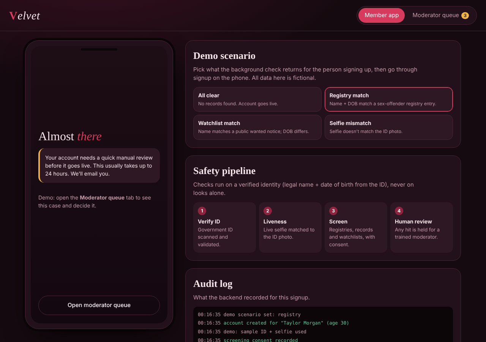
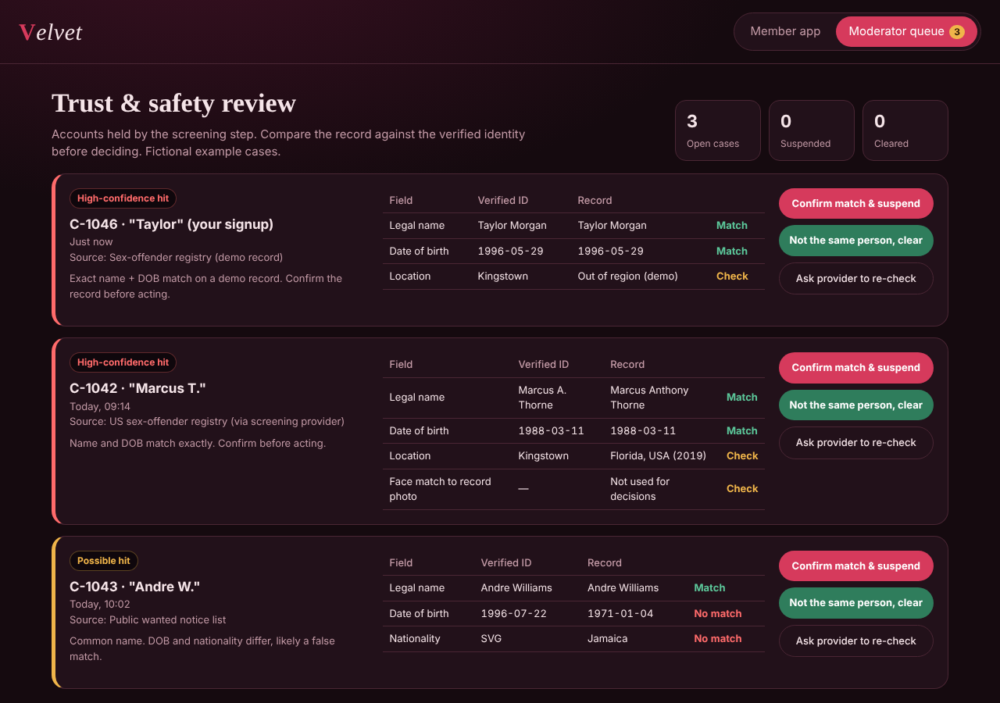

# Velvet: Safety-First Dating App Prototype

Velvet is an interactive prototype of a dating app where every member is ID-verified and screened for safety before they can see or message anyone. It focuses on the trust and safety design: identity verification, background screening with consent, and human review of flagged accounts, so that no one is publicly accused on the basis of a look-alike photo or a shared name.




## Features

**Member app**
- Signup with legal name and date of birth (under-18s are blocked)
- Government ID upload and live-selfie verification step
- Explicit consent screen for safety screening
- Step-by-step checks: ID authenticity, selfie match, sex-offender registries, wanted notices and sanctions lists, criminal records
- Discovery cards with "ID verified" badges, likes, matches, and chat
- In-chat safety tools: video call before meeting, "share my date" with a trusted contact, report and block
- Scam-pattern nudges (money requests or phone numbers shared early)

**Moderator queue**
- Flagged accounts are held and hidden from discovery, and no other member is notified
- Field-by-field comparison of the verified identity against the matched record
- Actions: confirm and suspend, clear as a false match, or request a re-check
- Member reports feed into the same queue

**Demo controls**
- Switch the screening result between *All clear*, *Registry match*, *Watchlist match* and *Selfie mismatch*
- An audit log shows what the backend would record at each step

## Design principles

1. **Match on verified identity, not looks.** Checks use the legal name and date of birth from a verified ID. Face similarity alone never triggers action.
2. **Humans decide.** Any hit goes to a trained moderator, never straight to other users.
3. **Due process.** False matches are cleared quietly, and people can dispute a decision.
4. **Data minimisation.** ID images are deleted after verification; only the result and a reference are kept.

## Run it

It's a single self-contained HTML file with no build step:

```bash
git clone https://github.com/Jody2905/velvet-dating-app.git
cd velvet-dating-app
open index.html   # or double-click it
```

Or enable **GitHub Pages** (Settings → Pages → Deploy from branch → `main` / root) to host it for free.

## Status and roadmap

This is a front-end prototype. All profiles, records and check results are fictional and simulated in the browser.

Planned for a production version:
- Backend (Node/Express or Django) with PostgreSQL for users, matches and review cases
- Authentication and role-based access for moderators
- Integration with an ID-verification provider (e.g. Persona, Onfido, Veriff) in sandbox mode
- Integration with a licensed background-check provider, with jurisdiction-aware rules
- Real-time chat and video
- Encryption at rest, audit logging and data-retention policies

## Tech

HTML, CSS and vanilla JavaScript. Fonts: Cormorant Garamond and DM Sans (Google Fonts).

## Author

Jody-Ann Trimmingham · [GitHub @Jody2905](https://github.com/Jody2905)
